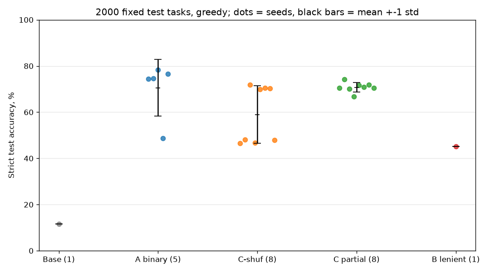
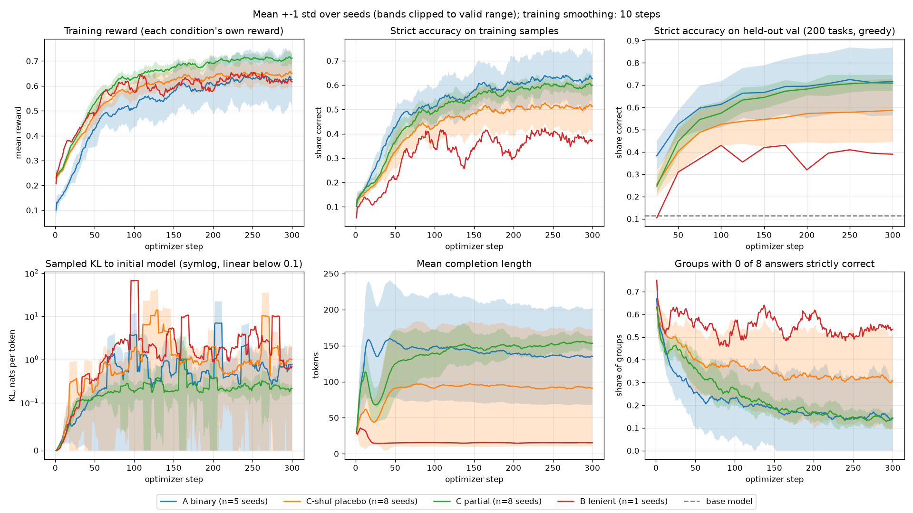

# Влияние функции награды на дообучение Qwen3 в задаче Countdown

Сессионный проект по RL, трек 3. Qwen3-0.6B дообучена с LoRA через `trl.GRPOTrainer`. Завершены 22 прогона по 300 шагов; итоговая оценка - на 2000 отложенных задачах.

## Вопрос и гипотеза

Проверяем, помогает ли частичная награда информацией о близости к цели или достаточно создать разброс наград там, где все ответы неверны.

В GRPO модель выдаёт на одну задачу группу из 8 ответов. Если все награды одинаковы, advantage (нормированная разница со средней наградой группы) равен нулю. KL-штраф за отклонение от исходной модели продолжает действовать. Частичная награда может дать сигнал и среди неверных ответов. Для контроля её оценки перемешиваются между допустимыми, но неточными выражениями внутри той же группы.

Гипотеза: согласованная с близостью награда C даст более высокую строгую точность, чем переставленная C-shuf. Основная метрика - разность средних точностей C и C-shuf по 8 seed. Вопрос, гипотеза, условия и правило решения записаны до основной серии в [PLAN.md](PLAN.md). После пилота, до основной серии, бюджет зафиксирован как 300 шагов.

| Условие | Награда | Seed обучения |
|---|---|---|
| A, binary | 1 за строго верный ответ, иначе 0 | 0-4 |
| C, partial | 1 за строго верный; за правильные числа и неверное значение `0.5 * max(0, 1 - abs(v-t)/t)`; иначе 0 | 0-7 |
| C-shuf, shuffled | как C, но оценки неточных выражений переставлены внутри группы, включая нулевые | 0-7 |
| B, lenient | как C, но допустимость чисел проверяется по принадлежности исходному множеству | 0, иллюстрация лазейки |

Перестановка сохраняет мультимножество наград **для одной и той же группы ответов**. Политики обучаются отдельно, поэтому в последующих шагах их ответы и распределения наград уже могут различаться.

## Задачи и проверка

Задачи сгенерированы скриптом `countdown.py`. Берутся 3 числа из 1-25, строится случайное допустимое выражение над всеми числами, а его значение становится целью. Сохраняются целые цели 10-100, отличные от каждого исходного числа и их суммы. В данных записано эталонное выражение для проверки генератора. Обучающий промпт содержит числа, цель, правила и пример формата ответа.

Seed генератора (начальное значение для воспроизведения случайного выбора) - 0. Дубликаты удалены по ключу `(отсортированные числа, цель)`. Каждая задача принадлежит одному срезу: calib 300, train 5000, val 200, test 2000. Они сохранены в [data/](data/) вместе с контрольными суммами. Сложность подбиралась на calib: на 4 числах база дала 0 верных ответов из 64, на выбранных 3 числах точность базы на CPU составила 11,3%. На H100 до основной серии получены 10,3% на calib, 11,5% на val и 11,65% на test. Это соответствует требованию 10-50% до обучения. Итоговая оценка охватывает модели основной серии.

Проверяется последняя полная пара тегов `<answer>...</answer>`. Выражение разбирается через `ast`: допустимая грамматика состоит из целочисленных литералов, скобок и бинарных `+ - * /`. Мультимножество чисел должно совпасть с исходным. Значение вычисляется точной рациональной арифметикой `Fraction`; деление на ноль даёт неверный ответ. Промежуточные результаты могут быть дробными и отрицательными.

Например, для `[3, 7, 25] -> 46` ответ `<answer>25 + 3 * 7</answer>` верен, а `<answer>25 + 7 + 7 + 7</answer>` использует числа неправильно.

## Обучение и оценка

Модель [Qwen3-0.6B](https://huggingface.co/Qwen/Qwen3-0.6B) содержит около 0,6 млрд параметров. В запусках использовался снимок `c1899de289a04d12100db370d81485cdf75e47ca`. Чат-шаблон вызывается с `enable_thinking=False`. Модель может писать рассуждения обычным текстом.

| Параметр | Значение во всех условиях |
|---|---|
| Алгоритм | `trl.GRPOTrainer` 1.16.0, `loss_type="dapo"` |
| Адаптация | LoRA r=32, alpha=64, все линейные слои |
| Learning rate | 1e-5, линейное снижение до нуля |
| Бюджет | 300 шагов, по 32 задачи и 8 ответов на задачу; всего 76800 ответов на прогон |
| Обновления | `num_iterations=1`, один процесс, micro-batch 32, gradient accumulation 8 |
| Нормировка | `scale_rewards="group"` |
| KL | `beta=0.01`, reference - исходная модель с отключённой LoRA |
| Генерация при обучении | temperature 1, максимум 256 токенов |
| Оценка | greedy (выбор наиболее вероятного токена), максимум 256 токенов, тот же промпт и чекер |

Данные, промпт, модель и остальные гиперпараметры одинаковы. Бюджет фиксирован по числу задач и ответов. Число токенов и время различаются, поскольку длина ответов зависит от награды. Прогоны выполнялись последовательно на H100 80GB. Суммарное время внутри `trainer.train()` составило 15,1 часа. Использовались torch `2.13.0+cu129`, vLLM `0.31.0+cu129`, transformers 5.17.0 и peft 0.21.2. Полный серверный `pip freeze` - в [requirements.txt](requirements.txt).

Промежуточные модели каждые 25 шагов оценивались на val для построения кривых обучения. Итоговая оценка на test проведена для адаптеров после 300 шагов. Серия прошла в два этапа: 15 и 7 полных прогонов. В результатах представлены все завершённые прогоны, включая модели с низкой точностью.

## Результаты

Таблица показывает среднюю точность по seed и выборочное стандартное отклонение для условий с несколькими прогонами. База и B представлены одним результатом каждая. Все модели проверены на одних и тех же 2000 задачах test.

| Условие | Число seed | Точность test, % | SD, п.п. |
|---|---:|---:|---:|
| База без дообучения | 1 | 11,65 | - |
| A, binary | 5 | 70,52 | 12,30 |
| C, partial | 8 | 70,76 | 2,10 |
| C-shuf, shuffled | 8 | 58,96 | 12,47 |
| B, lenient | 1 | 45,15 | - |



Проверка гипотезы использует заранее заданное правило. Если 95% доверительный интервал (ДИ) Уэлча для C минус C-shuf целиком лежит в пределах 3 процентных пунктов от нуля, считаем эффект практически малым. Иначе ДИ выше нуля означает преимущество C, ниже нуля - преимущество C-shuf; пересечение нуля даёт неопределённый результат. Единица сравнения - прогон обучения.

| Сравнение | Разность, п.п. | 95% ДИ Уэлча, п.п. |
|---|---:|---:|
| **C минус C-shuf, основное** | **+11,79** | **[+1,34; +22,25]** |
| C минус A | +0,24 | [-14,96; +15,43] |
| C-shuf минус A | -11,56 | [-27,58; +4,46] |

По заданному правилу гипотеза подтверждается: согласованная с близостью награда лучше этого контроля с перестановкой. ДИ допускает выигрыш меньше 3 п.п. Парная проверка по одинаковым seed, выполненная дополнительно после основной, даёт ДИ [+1,53; +22,06] п.п. и также указывает на преимущество C.

У C и A близкие средние. Широкий ДИ разности допускает преимущество любой из двух наград, поэтому сравнение остаётся неопределённым. В этих запусках C дала меньший разброс: диапазон точности 66,75-74,25%, тогда как A - 48,70-78,30%. У C-shuf четыре seed остаются около 47%, остальные выходят примерно на 70%.

## Динамика и поведение



Линия - среднее по seed; полоса охватывает 1 стандартное отклонение в обе стороны с учётом допустимого диапазона метрики. Обучающие кривые сглажены скользящим средним по 10 шагам для каждого seed, на val показаны исходные оценки чекпоинтов. B представлен линией единственного seed. KL показан на symlog-шкале, линейной около нуля. TRL оценивает KL по сгенерированным токенам; формула приведена в [документации GRPOTrainer](https://huggingface.co/docs/trl/grpo_trainer).

У C и A растут и обучающая точность, и точность на val. У C-shuf рост слабее и больше зависит от seed. У B обучающая награда растёт заметно сильнее строгой точности. Качество между условиями сравнивается по строгой точности.

В конце обучения, за последние 25 шагов, средняя длина ответа составляла около 135 токенов у A, 155 у C, 92 у C-shuf и 15 у B. Доли обрезанных обучающих ответов - 23,7%, 33,1%, 18,5% и 0% соответственно. Форма ответа и фиксированный лимит взаимодействуют с наградой. В test у A в среднем 12,8% ответов содержат неполную пару тегов или пропускают её целиком. У C и C-shuf полная пара присутствует почти во всех ответах. В отдельных примерах длинное рассуждение обрывается до финального выражения; это одно из возможных объяснений пропусков.

В оценке KL есть резкие всплески: максимальное логированное значение отдельного шага достигает примерно 791 у C-shuf. Все 6600 значений конечны. Выборочная оценка чувствительна к редким большим отношениям вероятностей. Эти всплески требуют отдельной диагностики устойчивости политики.

### Одни и те же задачи до и после

Примеры взяты из первых десяти задач test, все адаптеры - seed 0. В ячейках показано последнее выражение в тегах; число после стрелки - требуемая цель.

| Задача | База | A | C-shuf | C | B |
|---|---|---|---|---|---|
| `[1, 21, 21] -> 42` | `21+21`, пропуск 1 | `21*(21/21)`, неверные числа | `21+21*1`, верно | `21+21/1`, верно | `21+21`, пропуск 1 |
| `[20, 23, 16] -> 13` | `23+16-20`, неверно | `20+16-23`, верно | `23-20+16`, неверно | `20+16-23`, верно | `23-20+16`, неверно |
| `[12, 13, 5] -> 20` | `13+5`, пропуск 12 | `12+13-5`, верно | `13+12-5`, верно | `13+12-5`, верно | `13+12-5`, верно |

Полная таблица десяти задач и примеры ошибок выведены скриптом в [results/analysis.md](results/analysis.md). Например, для `[5, 24, 2] -> 58` C выводит `24 + 5 * 2`: числа использованы правильно, но результат равен 34. Такое выражение получает частичную награду, хотя строгая оценка остаётся нулевой.

### Лазейка в B

На test у B найден **121 ответ из 2000 (6,05%)**, получающий награду 1 при нарушении строгих правил. Например:

- `[1, 21, 21] -> 42`: `21 + 21`, число 1 пропущено;
- `[8, 1, 11] -> 88`: `11 * 8`, число 1 пропущено;
- `[5, 10, 5] -> 75`: `10 * 5 + 5 * 5`, число 5 использовано три раза вместо двух.

Нестрогая проверка засчитывает 51,20% ответов, строгая - 45,15%. B получает полную награду и за выражения с пропущенными или повторёнными числами. В C проверяется мультимножество; модель обучена с этой проверкой и тем же бюджетом. Для B выполнен один прогон, поэтому найденные примеры иллюстрируют reward hacking; оценка эффекта исправления зависит от этого единственного seed.

## Интерпретация и ограничения

В этом опыте согласованная с близостью к цели награда дала более высокую точность, чем выбранный случайный контроль. Перестановка одновременно разрушает связь оценки с близостью и добавляет шум в обновления. Сравнение C и C-shuf оценивает совместный эффект этих изменений.

Среди неточных допустимых ответов C-shuf 2,3% были единственными такими ответами своей группы, 37,9% находились в группах с одинаковыми частичными наградами. После перестановки исходная оценка сохранилась у 69,4% ответов. В последнюю величину входят совпадения при перестановке и равные оценки. При одинаковых частичных наградах перестановка сохраняет исходный сигнал. Эти доли описывают пересекающиеся множества ответов.

Остальные ограничения:

- результаты относятся к одной небольшой модели с LoRA, одному промпту и задачам с тремя числами;
- ДИ отражает разброс точности между seed на фиксированном test;
- генератор распределял уникальные задачи по срезам последовательно, в порядке появления: средняя цель train 38,38, test 36,43. Такое разбиение сохраняет зависимость срезов от порядка генерации;
- бюджет фиксирован по числу ответов, время и число токенов зависят от награды; генерация vLLM может различаться между запусками с одинаковым seed;
- сравнения с A и парная проверка дополняют основной анализ; вывод опирается на заранее выбранное C минус C-shuf.

Следующий эксперимент - контроль с фиксированным бонусом за правильный набор чисел. Он поможет проверить вклад этого бонуса в обучение. Ещё стоит повторить опыт с другим лимитом ответа и с четырьмя числами.

## Код, результаты и запуск

| Файл | Назначение |
|---|---|
| `countdown.py`, `test_countdown.py` | генератор, проверка, награды; проверки лазеек и непересечения срезов |
| `train.py`, `evaluate.py` | обучение одного условия и greedy-оценка базы/адаптеров |
| `analyze.py`, `test_analyze.py` | графики, таблицы и проверка привязки метрик к шагам |
| `data/` | задачи, эталонные решения и SHA256SUMS |
| `results/val.jsonl`, `results/test.jsonl` | сохранённые ответы и исходы проверки; повторные строки `(модель, задача)` сведены к последней оценке |
| `results/training.csv` | компактные метрики всех шагов, включая диагностику C-shuf; достаточно для повторения графиков на CPU |
| `results/test_by_seed.csv`, `results/analysis.md` | итоговые числа по seed и полный вывод анализа |
| `results/run_metadata.json` | время обучения и дополнительные характеристики прогонов |
| `requirements.txt`, `requirements-analysis.txt` | серверный freeze и версии библиотек анализа |

Сырые обучающие ответы и веса адаптеров хранятся отдельно, в `runs/`. Метрики для проверки выводов и построения графиков сохранены в `results/`.

### Повторить анализ на CPU

Нужен Python 3.13. Запуск из корня проекта:

```bash
uv venv --python 3.13 .venv
source .venv/bin/activate
uv pip install -r requirements-analysis.txt
python test_countdown.py
python test_analyze.py
python analyze.py > results/analysis.md
```

`analyze.py` строит `figures/training.png`, `figures/test.png` и таблицы по полному каталогу `runs/` или сохранённому `results/training.csv`. Пересчёт из обучающих ответов требует все сырые прогоны; при неполном наборе скрипт останавливается и сохраняет полную таблицу. Для анализа сохранённых метрик передайте `--runs /tmp/no-raw-runs`, указав путь к несуществующему каталогу.

### Повторить обучение на GPU

Нужны Linux x86_64, GPU с bf16 и совместимый CUDA-драйвер; использовались H100 и Python 3.11. Установка серверного окружения и пример одного прогона:

```bash
uv venv --python 3.11 .venv-gpu
source .venv-gpu/bin/activate
uv pip install -r requirements.txt --extra-index-url https://download.pytorch.org/whl/cu129 --index-strategy unsafe-best-match
export VLLM_USE_FLASHINFER_SAMPLER=0
python test_countdown.py
(cd data && sha256sum -c SHA256SUMS)
python evaluate.py --split test --vllm --out results_repro
python train.py --reward partial --seed 0 --steps 300 --out runs_repro
python evaluate.py --split val --vllm --adapters runs_repro/partial_s0/checkpoint-* --out results_repro
python evaluate.py --split test --vllm --adapters runs_repro/partial_s0/final --out results_repro
```

Для полной серии тот же набор команд повторяется для A с seed 0-4, C и C-shuf с seed 0-7 и B с seed 0. Условия задаются через `--reward binary|partial|shuffled|lenient`, seed через `--seed`; пути адаптеров в оценке меняются соответственно. Повторные прогоны сохраняются в `runs_repro/` и `results_repro/`. После полной серии анализ вызывается с `--runs runs_repro --results results_repro` из CPU-окружения анализа. Для повторения используются сохранённые срезы в `data/`; команда `python countdown.py` воссоздаёт их с seed 0. Оценки дописываются в jsonl, а анализ убирает дубли по модели и номеру задачи. Кривые по шагам строятся по всем чекпоинтам; итоговая точность - по `final`.

